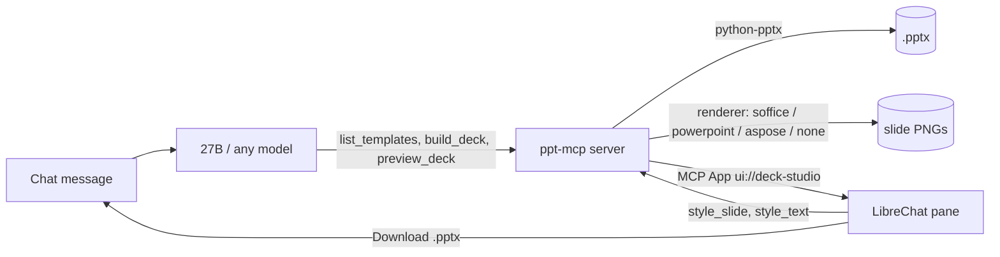

# ppt-deck-mcp

An MCP server that builds **corporate PowerPoint decks** from a plain-language request, plus an
interactive pane inside LibreChat for previewing, restyling and downloading them.

Designed for a **small local model** (Qwen3.6-27B in 3-bit) as the driver: the model emits structure,
the server owns layout. It also works with any MCP client.

**Status (2026-10-26):** 100-case corpus **97/100**, plus 8 regression cases **8/8** (all 3 former failures now pass) · **159 unit tests** · 16 browser checks · concurrency probe **6/6 parallel renders** · previews render **warm** (one LibreOffice, direct PNG, per-slide cache) · CI green on Python 3.12 & 3.13.



## Tools

| Tool | Purpose |
|---|---|
| `list_templates` | template catalog with theme metadata + preview images |
| `build_deck` | one call: outline (bullets / native chart / table / image) → `.pptx`. **One visual per slide** |
| `verify_deck` | safety net: check slide count + requested visuals against the ask, returns concrete `problems` |
| `preview_deck` | render a deck and open the **Deck Studio** pane |
| `get_deck_outline` | read a `.pptx` back as an editable outline, including per-slide `style` |
| `style_slide` | per-slide formatting in place: size, colour, font, alignment, bold/italic |
| `style_text` | per-run emphasis: bold/italic/colour a specific phrase |
| `import_deck` | bring a chat-uploaded `.pptx` into the workspace |
| `get_last_deck` / `list_decks` | find decks for editing |
| `render_svg` | SVG markup → transparent PNG for slide graphics |

**Concurrency:** builds write unique names atomically, renders serialise per deck id, and each
LibreOffice run uses a throwaway profile — several users can render at once (`tests/concurrency_check.py`).

The editing tools include slide inspection, text, shapes, charts, tables, images, hyperlinks,
connectors, slide masters, and presentation properties. They accept a deck ID and return a new deck
ID for each edit. Apply edits sequentially and preview the final ID. The source deck stays intact.
Their underlying operations come from the vendored MIT PowerPoint server; its original presentation
handles and unrestricted file operations are not exposed.

`style_slide` and `style_text` update the selected deck in place. Font-file analysis and subsetting
are not exposed. Applying a new PowerPoint theme to an existing deck and slide transitions were
placeholders in the original tools; picture effects currently support rotation only. Some template
decorations are simplified.

## Deck Studio pane (LibreChat, no fork)

A tool that declares `_meta.ui.resourceUri` gets an interactive view in the chat: slide thumbnails,
click-to-zoom, a 5-template gallery, per-slide style controls, per-phrase emphasis, "Ask agent to
edit", and a **Download .pptx** button. Styling calls the server **directly** over the MCP Apps
bridge — no model, no tokens — with one approval click. Details: [`docs/decisions.md`](docs/decisions.md).

**Viewing a deck**: click a slide (or focus it and press Enter) to open the viewer. `←`/`→` step
through slides, `Home`/`End` jump to the ends, `Esc` closes and returns focus to the slide you came
from. Per-slide actions (`Style…`, `Ask agent…`) sit *below* each thumbnail rather than floating over
the image, so they are always visible, keyboard-reachable and usable on touch.

**Languages**: the pane ships **English and Canadian French** (`English | Français` in the corner).
Every string is in one dictionary, the default follows `hostContext.locale` and then
`navigator.language`, a manual choice wins afterwards, and switching updates `<html lang>` so screen
readers change voice. `tests/test_regressions.py` fails the build if a string is missing from either
language.

> **Known gap — LibreChat's own chrome is English.** "Open app" / "Close app" and the raw tool name on
> the attachment card (`preview_deck`) stay English in a French UI. `client/src/locales/fr/
> translation.json` upstream has **no `com_ui_mcp_app_*` keys at all**, and the card renders the raw
> tool name with no support for a tool `title`. Fixing it belongs upstream, not in a local patch —
> see [Localising the host (LibreChat)](#localising-the-host-librechat).

**Accessibility**: the pane targets WCAG 2.2 AA (AODA / Accessible Canada Act): every control is a
native button with a ≥32px target, text contrast is ≥4.5:1, the viewer is a modal `<dialog>` with a
manual Tab wrap (the browser's trap stops at the iframe boundary), slide changes are announced
politely, and `prefers-reduced-motion` / `prefers-contrast` are honoured. These invariants are pinned
by unit tests, and the interactive half by the Playwright check.

If the chat column looks narrow on a widescreen display, that is LibreChat's message width, not the
pane — see `~/dev/librechat/local-ui/README.md` for the one-file stylesheet fix.

**Dev preview without a model turn**: open
`http://decks.local:8931/apps/deck_studio/dev-preview.html?deck=<previews-dir>` — it loads the real
`index.html` + `app.js` against a fixture tool result, so layout, the language switch, contrast and
keyboard behaviour can be checked in a plain tab. It is a dev harness only; nothing in normal use
reaches it.

> **Heads-up — it is reachable to anything that can reach the MCP origin.** The asset route serves every
> file in `apps/deck_studio/` without authentication, so `dev-preview.html` is readable by any process or
> container that can hit the server (dev: `172.17.0.1:8931` / `decks.local:8931`). It has no filesystem
> or tool access and carries fixture data only, but a production deployment should remove it or gate it
> behind a dev flag. See [Hardening](#hardening).

## Localising the host (LibreChat)

Two of the strings a French user sees around this pane are not ours, and neither can be fixed without
touching LibreChat. Both are small upstream changes — no fork required. Hand this to whoever owns the
LibreChat deployment:

> **Task: finish French localisation of MCP Apps in LibreChat**
>
> 1. `client/src/locales/fr/translation.json` is missing every `com_ui_mcp_app_*` key that the English
>    file defines (`com_ui_mcp_app_open`, `…_close`, `…_open_named`, `…_close_named`, `…_frame_title`,
>    `…_failed_to_load`, `…_stop`, `…_at_capacity`, the `confirm_*` and `action_warning` keys, …), so a
>    French UI falls back to "Open app" / "Close app". Add fr-CA translations for the whole block
>    (`Ouvrir l'application`, `Fermer l'application`, `Ouvrir l'application : {{0}} ({{1}})`, …).
> 2. `client/src/components/MCPUIResource/MCPAppViews.tsx` renders the raw MCP tool name on the
>    attachment card (`preview_deck`). Use `annotations.title` from the MCP tool definition when the
>    server provides one, falling back to the tool name — the same courtesy `toolLabels.ts` already
>    extends to a few built-in tools.
> 3. `client/src/hooks/MCP/useAppBridge.ts` builds the App host context with
>    `const { locale } = Intl.DateTimeFormat().resolvedOptions()`, i.e. the **browser/OS** locale. The
>    language the user actually chose in **Settings → Language** is applied to
>    `document.documentElement.lang` in `client/src/locales/i18n.ts`, but is never forwarded to the App.
>    Send `i18n.language` (or `document.documentElement.lang`) as the host context `locale` instead, so
>    an app can follow the user's product choice rather than their operating system.
>
> Acceptance: set the UI language to French, open any MCP App — the open/close controls, the card label
> and the App's own default language are all French, including on a browser whose OS language is
> English.

Until item 3 lands, this pane follows the browser locale, then `navigator.language`, and the
`English | Français` toggle is the reliable override. Item 1 + 2 need no changes here; item 3 is the
one that makes the pane's default match LibreChat's Language setting.

### Paste-ready prompt for a vendored LibreChat copy

If you maintain your own LibreChat checkout (rather than upstream), hand the block below to whoever —
or whatever — is doing the edit. It is written to be self-contained and testable, and it changes
nothing outside LibreChat.

```text
Task: finish MCP Apps localisation (French / fr-CA) in this LibreChat checkout.

Context: MCP App panes (tools that declare _meta.ui.resourceUri) render inside an iframe that
LibreChat wraps with its own "Open app" / "Close app" controls and labels with the raw MCP tool name.
A French UI therefore shows English chrome, and each App's own default language ignores the user's
Language setting because only the OS/browser locale is forwarded.

Do these four things:

1. client/src/locales/fr/translation.json — add fr-CA values for all 17 keys that exist in
   client/src/locales/en/translation.json and contain "mcp_app" (grep for com_ui_mcp_app_). They are
   currently missing, so i18next falls back to English. Suggested wording:
     com_ui_mcp_app_open            -> "Ouvrir l'application"
     com_ui_mcp_app_close           -> "Fermer l'application"
     com_ui_mcp_app_open_named      -> "Ouvrir l'application : {{0}} ({{1}})"
     com_ui_mcp_app_close_named     -> "Fermer l'application : {{0}} ({{1}})"
     com_ui_mcp_app_frame_title     -> "Application MCP : {{0}}"
     com_ui_mcp_app_failed_to_load  -> "La vue interactive n'a pas pu se charger."
     com_ui_mcp_app_stop            -> "Fermer l'application et arrêter les requêtes"
     com_ui_mcp_app_at_capacity     -> "Fermez une autre application avant d'ouvrir celle-ci."
     com_ui_mcp_app_confirm_tool    -> "Exécuter l'outil depuis l'application ?"
     com_ui_mcp_app_confirm_message -> "Envoyer un message depuis l'application ?"
     com_ui_mcp_app_run_tool        -> "Exécuter l'outil"
   Translate the remaining com_ui_mcp_app_* keys you find in the same style (fr-CA: "application",
   "requête", "autoriser"; no France-specific wording). Keep {{0}}/{{1}} placeholders verbatim.

2. client/src/components/MCPUIResource/MCPAppViews.tsx — the card shows <span>{app.toolName}</span>.
   Display a human label instead: use the MCP tool's annotations.title (or top-level title) when the
   server provides one, fall back to toolName. Do NOT change the underlying tool id: agent configs
   reference ids like "preview_deck_mcp_ppt".

3. client/src/hooks/MCP/useAppBridge.ts — the App host context is built with
   `const { locale } = Intl.DateTimeFormat().resolvedOptions()` (the OS/browser locale). Send the
   language the user chose in Settings -> Language instead, i.e. i18n.language (already applied to
   document.documentElement.lang in client/src/locales/i18n.ts). Keep the value a BCP-47 tag.

4. Same file — the bridge only calls bridge.setHostContext() on resize/theme changes. Subscribe to
   i18n.on('languageChanged') and re-send setHostContext({ ...hostContext, locale }) so an already
   open App switches language without being reopened. Unsubscribe on cleanup.

Constraints: no other behaviour changes; keep en untouched; follow the existing i18n and React
patterns in those files; add/adjust unit tests (the locale test in client/src/locales/Translation.spec.ts
is the model).

Acceptance:
- Set UI language to French, open any MCP App: open/close controls and the card label are French.
- An App that reads hostContext.locale receives "fr..." (not the OS locale) and its own UI is French.
- Changing Settings -> Language while an App is open updates that App without reopening it.
- Switching back to English restores English chrome and en-CA/en locale.
```

Nothing in this repository depends on those changes; they only remove the English chrome around the
pane and make the pane's default language follow the product setting.

### Localising this server

All pane strings live in one place: the `STRINGS` object in `apps/deck_studio/app.js` (`en` and `fr`
tables). To add a third language:

1. Add a table next to `fr` and a `<button id="lang-xx">` in `apps/deck_studio/index.html`.
2. Extend `pickInitialLang()` (it already matches `hostContext.locale` then `navigator.language`).
3. Run the tests — `tests/test_regressions.py` fails if any key used by the HTML **or** by `t(...)` is
   missing from *either* table, so a half-finished translation cannot ship.

The MCP tool labels are separate and bilingual on purpose: tool ids must stay ASCII
(`preview_deck`), so the human label rides in `annotations.title` / `title`
(`Deck preview / Aperçu du diaporama`) and hosts that ignore it simply fall back to the id.

## Locking it down

Everything below is implemented and tested (`docs/security.md` has the evidence and the remaining
backlog; `docs/authz-model.md` has the identity/entitlement model).

### 1. Turn authentication on

| `PPT_AUTH_MODE` | Use | Enforces |
|---|---|---|
| `none` | development only | nothing — the server **refuses to start** when `PPT_ENV=prod` |
| `token` | single user, or a same-host hop | one shared bearer, constant-time compared |
| `entra` | production | Entra ID access tokens: RS256 against the tenant JWKS (kid rotation), exact `iss`, `aud`, `tid`, `ver` 2.0, plus `scp` or an app role |

```sh
# production, Entra
PPT_ENV=prod PPT_AUTH_MODE=entra \
PPT_ENTRA_TENANT_ID=<tenant-guid> PPT_ENTRA_AUDIENCE=<api-app-client-id> \
PPT_ENTRA_REQUIRED_SCOPES=Decks.Read PPT_ENTRA_REQUIRED_ROLES=Decks.Access \
PPT_URL_SECRET=<32+ random bytes, hex>   # otherwise download links die on every restart
```

Entra does not support the RFC 8707 `resource` parameter, so audience binding is validated from the
`aud` claim; `tid` is checked separately from `iss`; identity is `oid`/`sub` (never
`preferred_username`/`upn`/`email`).

#### LibreChat needs two things from us (both documented, both required)

Verified on v0.8.9-rc1:

1. **It ignores `headers:` on the MCP transport** — with a bearer configured it still sent `POST /mcp`
   with no Authorization header.
2. **It probes every server unauthenticated at startup**, and a 401 whose `WWW-Authenticate` mentions
   `Bearer` marks the server `requiresOAuth: true` for the process lifetime, after which every tool call
   runs an OAuth flow instead of using the URL
   ([upstream discussion #9178](https://github.com/LibreChat-AI/LibreChat/discussions/9178)).

So the deployment shape is:

```yaml
mcpServers:
  ppt:
    type: streamable-http
    url: http://mcp-gateway:8931/mcp
    requiresOAuth: false        # skip the unauth probe entirely
```

plus the **token-broker gateway** in [`deploy/mcp-gateway/`](deploy/mcp-gateway/): it obtains a real OAuth
access token (client credentials) from Entra/Keycloak, injects it, refreshes it, publishes no host port,
and normalises the two protocol quirks that would otherwise surface as "auth failed" (wildcard `Accept`,
empty liveness probes). The MCP server stays in `entra` (or `token`) mode and validates every request; the
credential lives only in the gateway.

LibreChat side — `deploy/librechat/mcpServers.ppt.yaml`:

```yaml
  ppt:
    headers: { Authorization: 'Bearer ${PPT_MCP_TOKEN}' }     # token mode
    # or the `oauth:` block with api://<PPT_ENTRA_AUDIENCE>/Decks.Read   (entra mode)
```

> LibreChat probes `/mcp` **without** a bearer at startup. In `token` mode the 401 must not advertise
> `resource_metadata`, or LibreChat reports `OAuth Required: true`, lists 0 tools and never calls them —
> the server already does the right thing per mode; don't add OAuth metadata to a token deployment.

### 2. Keep the data paths in bounds

- Decks are read only from `PPT_OUTPUT_DIR`, `PPT_UPLOAD_DIR`, `PPT_TEMPLATE_PATH` and
  `PPT_ALLOWED_ROOTS`; paths are resolved first, so a symlink cannot escape.
- Tool results never contain a filesystem path: callers get opaque ids (`d…` for decks, `i…` for rendered
  images) and the id → file index lives in `previews/.index/`, outside the served tree.
- Slide images and the `.pptx` require an HMAC signature (`?exp=&sig=&sub=`) when authentication is on;
  nothing else in a preview directory is served.

### 3. Decide who owns what

Entra proves *who*, LibreChat holds *what the product allows* (agents, tools, skills, sharing), and this
server enforces *which deck*: decks are owned by the subject that created them, another subject gets
"unknown deck id", and the render cache is namespaced per subject. LibreChat's RBAC is **not** a boundary
on this port — a direct caller never goes through it.

### 4. Audit and network

```sh
PPT_AUDIT_LOG=<path>/audit.jsonl     # JSONL: tool.call, asset.get, auth.reject
PPT_AUDIT_MAX_BYTES=10485760         # rotates, one previous file kept — ship it to the SIEM
```

- Bind to loopback or, on Windows, to the LibreChat host only; the installer adds a firewall rule limited
  to that address plus an outbound block on `soffice.exe` (untrusted decks must not reach the network).
- Prefer `--transport stdio` for a single-user Windows deployment: no network surface at all.
- Rendering is still LibreOffice parsing untrusted files; treat the sandbox as part of the deployment
  (`docs/security.md` item 3) — a dedicated low-privilege account, no egress, timeouts.

### 5. Test the OAuth path without a cloud tenant

The container in [`deploy/oidc/`](deploy/oidc/) is a real authorization server (discovery, JWKS, token
endpoint) that mints Entra-shaped tokens, so the resource-server side can be exercised end to end:

```sh
docker compose -f deploy/oidc/docker-compose.yml up -d      # http://localhost:8899
PPT_OIDC_REQUIRED=1 .venv/bin/python -m unittest tests.test_oidc_mock
```

It proves key fetch over HTTP, RS256 verification, audience/tenant rejection and a full MCP tool call with
a token — it does **not** prove Conditional Access or other tenant policy: one staging run against the real
Entra tenant is still required before go-live.

### 6. Verify, don't assume

```sh
.venv/bin/python -m unittest discover -s tests   # 171 tests: security, auth, audit, assets, regressions
curl -si -X POST http://host:8931/mcp | head -3  # 401 + WWW-Authenticate when auth is on
```

## Install

Three parts: the server, the prompts, the skills. Each is a few commands; the details live in
[`deploy/README.md`](deploy/README.md) (production checklist), [`skills/README.md`](skills/README.md) and
[`prompts/README.md`](prompts/README.md).

### 1. The server

```sh
git clone https://github.com/ryanhyma/ppt-deck-mcp && cd ppt-deck-mcp
python -m venv .venv && .venv/bin/pip install -r requirements.txt

# Previews need a renderer. Without one decks still build — thumbnails report preview_error.
sudo apt-get install --no-install-recommends libreoffice-impress     # Linux
# Windows: portable LibreOffice, one unzip — docs/windows-setup.md

# Run: stdio has no network surface at all; http needs authentication (next block).
.venv/bin/python server.py --transport stdio
PPT_AUTH_MODE=token PPT_MCP_TOKEN=$(openssl rand -hex 24) \
  PPT_PUBLIC_BASE=http://decks.local:8931 \
  .venv/bin/python server.py --transport http --host 127.0.0.1 --port 8931
```

Production (Entra, gateway, Windows service): [`deploy/README.md`](deploy/README.md) and
[`docs/windows-service.md`](docs/windows-service.md). Never expose `http` with `PPT_AUTH_MODE=none` —
the server refuses to start that way when `PPT_ENV=prod`.

Register the server with LibreChat (`librechat.yaml`), then restart it:

```yaml
mcpServers:
  ppt:
    type: streamable-http
    url: http://host.docker.internal:8931/mcp   # or http://mcp-gateway:8931/mcp behind the gateway
    timeout: 180000
    requiresOAuth: false        # REQUIRED: see "Locking it down" — an unauthenticated probe otherwise
                                # marks the server as OAuth-protected and every tool call fails
mcpSettings:
  apps: true                    # required for the Deck Studio pane
  allowedDomains: ['host.docker.internal', 'mcp-gateway']
  allowedAddresses: ['host.docker.internal:8931', 'mcp-gateway:8931']
```

Verify that LibreChat refreshes the PPT tool list, then build and preview a deck in a new chat.

### 2. The prompts (paste into two places)

| Where | What to paste | Why |
|---|---|---|
| LibreChat agent → **Instructions** | [`prompts/agent-deck-builder.md`](prompts/agent-deck-builder.md) (tested default), or [`prompts/main-prompt.md`](prompts/main-prompt.md) on a stronger model | the terse prompt is what the corpus was validated with; the main prompt adds user guidance and 11 workflows |
| `librechat.yaml` → `mcpServers.ppt.serverInstructions` | the YAML block in [`prompts/server-instructions.md`](prompts/server-instructions.md) | reaches the model even when Skills are disabled |

A ready-made agent config (tools, instructions, skill placeholders) is
[`deploy/librechat/agent-deck-builder.json`](deploy/librechat/agent-deck-builder.json).

### 3. The skills (copy, restart, then bind ids)

```sh
# 1. put the skill files where LibreChat reads them and restart it
cp -r skills/* /path/to/librechat/skill/        # container: /app/skill ; native: <deploy>\skill
docker restart LibreChat
# 2. the startup log must say:
#    [deploymentSkills] Loaded 2 deployment skill(s) from /app/skill
```

Then, and this is the part that silently fails: **skills are loaded read-only and are not Skill documents
in MongoDB.** An agent only uses them if it carries the MongoDB **ObjectIds** of the `Skill` documents
created from them, with `skills_enabled: true`. Names are dropped silently — a skill list that looks right
but holds stale ids leaves the agent with **no** skills (one agent on this box failed exactly that way,
reporting `missing_model`). Fill `{{SKILL_ID_PPT_DECK_BUILDER}}` / `{{SKILL_ID_SVG_GRAPHICS}}` in
[`deploy/librechat/agent-deck-builder.json`](deploy/librechat/agent-deck-builder.json) with real ids, or
re-create the skills in the UI and copy the ids from the agent document.

Deliberate redundancy: the prompts also carry the workflow, so a deployment with Skills switched off still
behaves. The skill file holds the detail (chart/table shapes, styling vocabulary, import caveats).

### 4. Check the install

```sh
tests/preflight.sh                                   # clean venv + CI interpreters + secret scan
curl -s -o /dev/null -w '%{http_code}\n' -X POST http://127.0.0.1:8931/mcp \
  -H 'Content-Type: application/json' -d '{}'        # 401 when auth is on
tail -3 <PPT_OUTPUT_DIR>/audit.jsonl                 # tool.call … outcome=ok after a chat
```

## Configuration

Environment variables, or a `ppt-mcp.config.json` beside `server.py` (env wins):

| Key | Env | Meaning |
|---|---|---|
| `renderer` | `PPT_RENDERER` | `auto` · `soffice` · `powerpoint` · `aspose` · `none` |
| `soffice_bin` | `SOFFICE_BIN` | path to `soffice(.exe)`; Windows portable is auto-detected |
| `template_path` | `PPT_TEMPLATE_PATH` | template directories |
| `output_dir` | `PPT_OUTPUT_DIR` | where decks and previews are written |
| `upload_dir` | `PPT_UPLOAD_DIR` | LibreChat uploads dir, for `import_deck` |
| `public_base` | `PPT_PUBLIC_BASE` | origin the browser/container uses to reach this server |
| `aspose_license_path` | `ASPOSE_LICENSE_PATH` | licence for the `aspose` renderer |
| `preview_width` | `PPT_PREVIEW_WIDTH` | rendered slide width in px (default **1600**; height follows the page ratio) |
| `warm_render` | `PPT_WARM_RENDER` | reuse one LibreOffice for PNG export (default on when pyuno is available) |
| `render_cache` | `PPT_RENDER_CACHE` | per-slide image cache (default on; `0` = always re-render, cold chain only) |
| `render_cache_max` | `PPT_RENDER_CACHE_MAX` | cached slide images kept before oldest are pruned (default 5000) |
| `render_queue_max` | `PPT_RENDER_QUEUE_MAX` | pending render jobs before `preview_error` says busy (default 256) |
| `render_timeout_s` | `PPT_RENDER_TIMEOUT_S` | per-deck render budget before the bridge is killed and restarted (default 180) |
| `uno_python` | `PPT_UNO_PYTHON` | interpreter that can `import uno`; auto-detected (system `python3`, or LibreOffice's `python.exe`) |
| `auth_mode` | `PPT_AUTH_MODE` | `none` (dev) · `token` · `entra` — see [Locking it down](#locking-it-down) |
| `env` | `PPT_ENV` | `prod` refuses to start with `auth_mode=none` |
| `mcp_token` | `PPT_MCP_TOKEN` | shared bearer for `token` mode |
| `entra_tenant_id` / `entra_audience` | `PPT_ENTRA_TENANT_ID` / `PPT_ENTRA_AUDIENCE` | `entra` mode: tenant + this API's client id |
| `entra_required_scopes` / `entra_required_roles` | `PPT_ENTRA_REQUIRED_SCOPES` / `…_ROLES` | Entra delegated scope **or** app role that may use the tools |
| `allowed_roots` | `PPT_ALLOWED_ROOTS` | extra directories decks may be read from (keep empty in prod) |
| `url_secret` | `PPT_URL_SECRET` | HMAC key for signed download/image URLs |
| `audit_log` | `PPT_AUDIT_LOG` | audit JSONL path (default `<output>/audit.jsonl`) |
| `audit_max_bytes` | `PPT_AUDIT_MAX_BYTES` | rotation threshold (default 10 MiB, one previous file) |

**`public_base` must be a hostname, not an IP address.** LibreChat's MCP App bridge refuses
host-opened links to IP address literals, which silently disables the Deck Studio **Download .pptx**
button. Map a name to the host bridge IP in `/etc/hosts` (e.g. `172.17.0.1  decks.local`) and set
`PPT_PUBLIC_BASE=http://decks.local:8931`. The server rejects an IP-literal base at startup.

**Rendering is a view dependency, never a data one.** Building and editing a `.pptx` needs no office
suite; without a renderer the deck still builds, downloads and reports `preview_error`.
Capacity: [`docs/renderers.md`](docs/renderers.md).

### How a preview is produced

```
preview_deck
  └─ per-slide cache key = sha256(engine, width, deck-wide parts, this slide's XML)
       ├─ hit  → hard-link the cached PNG (no LibreOffice involved)
       └─ miss → one warm LibreOffice (UNO) exports just those slides as PNG
                  └─ on any failure: cold chain (fresh soffice -> PDF -> PyMuPDF)
```

The warm renderer is a single `soffice` process owned by a bridge child process (`render_bridge.py`,
which runs under the interpreter that has pyuno). One worker thread talks to it, so concurrent
previews queue; identical requests for the same deck are coalesced into one render; a timed-out or
crashed bridge is killed and restarted. Unchanged slides are never re-rendered — editing one slide
re-renders one slide.

## Tests come first

`docs/tdd.md` is the standing rule: write the failing test, show the red run, then the smallest
implementation. Security work is where it pays — one test file per contract (scope, tokens, gate, audit),
each negative case pinned.

## Authentication (quick reference)

Full lockdown guide: [Locking it down](#locking-it-down) · model: [`docs/authz-model.md`](docs/authz-model.md) ·
gaps/evidence: [`docs/security.md`](docs/security.md).

| Mode | For | Enforces |
|---|---|---|
| `none` | development | nothing — **refused when `PPT_ENV=prod`** |
| `token` | single user / same-host hop | shared bearer (`PPT_MCP_TOKEN`) |
| `entra` | production | Entra ID access tokens: RS256 + tenant JWKS, `iss`, `aud`, `tid`, `ver` 2.0, `scp` or app role |

## Deployment assets

Everything a deployment needs is in the repo, not in somebody's home directory:

| Path | What it is |
|---|---|
| `prompts/main-prompt.md` | **start here**: the full prompt — core rules, model behaviour, 11 worked deck-building workflows, failure playbook, copy-paste example asks |
| `prompts/agent-deck-builder.md` | the terse production agent prompt, verbatim — with the defect each line prevents |
| `prompts/server-instructions.md` | the MCP `serverInstructions` that go into `librechat.yaml` |
| `skills/ppt-deck-builder/SKILL.md` | how to build/style/verify a deck (the main skill) |
| `skills/svg-graphics/SKILL.md` | SVG → PNG for icons and simple diagrams |
| `deploy/librechat/mcpServers.ppt.yaml` | the `mcpServers.ppt` block, incl. `mcpSettings.apps` and the OAuth/header shape |
| `deploy/librechat/agent-deck-builder.json` | importable agent config (tools, skills, instructions) |
| `deploy/windows/install-service.ps1` | venv + **NSSM** service, ACLs, firewall, log rotation, failure actions |
| `deploy/windows/ppt-mcp.env.example` | production environment switches incl. `PPT_AUTH_MODE=entra` |
| `docs/windows-service.md` | Windows runbook + the acceptance test list |
| `docs/authz-model.md` | Entra proves identity; LibreChat holds entitlements; this server enforces per-deck access |

Installation steps for all of it: [Install](#install). The per-area guides are
[`deploy/README.md`](deploy/README.md), [`skills/README.md`](skills/README.md) and
[`prompts/README.md`](prompts/README.md).

`tests/test_deployment_assets.py` keeps those assets honest: a renamed tool fails CI if the agent
config, the instructions or a skill still call it by the old name, and the installer's hardening flags
(log rotation, restricted port, LibreOffice egress block, service account) cannot be dropped silently.

## Tests

```sh
.venv/bin/python -m unittest discover -s tests -v     # 159 unit tests, ~8 s, no services
RUN_E2E=1 CONVO=<id> tests/run_all.sh                 # + 7 browser checks (needs the stack)
.venv/bin/python tests/run_suite.py --limit 10        # behaviour corpus, one chat per case
```

| Layer | What it covers |
|---|---|
| `tests/test_regressions.py` | one test per defect ever found (layout, styling, validation, renderers, import) |
| `tests/e2e/deck-studio.js` | the pane actually renders: iframe, CSP/CORS, thumbnails, gallery, controls, download |
| `tests/run_suite.py` + `tests/cases.json` | 100-case corpus against the local model, judged on the artefact |

CI (`.github/workflows/tests.yml`) runs the unit layer on 3.12 and 3.13. Results:
[`docs/SUITE-REPORT.md`](docs/SUITE-REPORT.md).

## Repository layout

```
server.py            entry point: vendored app + our tools + Deck Studio assets over HTTP
deck_tools.py        build_deck, style_slide, style_text, outline read-back
deck_style.py        theme-aware chrome (accent bar, title rule, footer, page numbers)
deck_preview.py      renderers (soffice/powerpoint/aspose/none), previews, download, import
apps/deck_studio/    the MCP App: HTML/JS view + vendored ext-apps 1.5.7 bundle
templates/           5 themed .pptx files + sidecar theme manifests
upstream/            vendored MIT server (unmodified)
tests/               unit, e2e, 100-case corpus + runner
prompts/             the agent system prompt + the MCP serverInstructions (drift-tested)
skills/              LibreChat deployment skills (ppt-deck-builder, svg-graphics)
deploy/librechat/    librechat.yaml mcp block + agent config to import
deploy/windows/      venv + NSSM service installer, uninstaller, env template
docs/                windows setup/service, renderers, decisions, authz model, suite report, security backlog
```

## Licence / provenance

**No top-level licence file yet** — the repo is public but all-rights-reserved until one is added
(MIT or Apache-2.0 would fit the rest of the stack; proprietary is also fine, just say so).

`upstream/` is MIT (GongRzhe/Office-PowerPoint-MCP-Server v2.0.7) and keeps its own `LICENSE`;
upstream demo media (67 MB of gif/mp4) was removed to keep the repo small.
