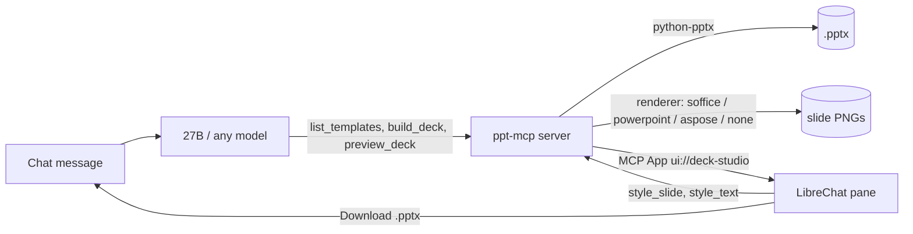

# ppt-deck-mcp

An MCP server that builds **corporate PowerPoint decks** from a plain-language request, plus an
interactive pane inside LibreChat for previewing, restyling and downloading them.

Designed for a **small local model** (Qwen3.6-27B in 3-bit) as the driver: the model emits structure,
the server owns layout. It also works with any MCP client.

**Status (2026-10-25):** 100-case corpus **97/100**, plus 8 regression cases **8/8** (all 3 former failures now pass) · 43 unit tests · 7 browser checks · concurrency probe **6/6 parallel renders** · CI green on Python 3.12 & 3.13.



## Tools (10 own + 37 vendored)

| Tool | Purpose |
|---|---|
| `list_templates` | template catalog with theme metadata + preview images |
| `build_deck` | one call: outline (bullets / native chart / table / image) → `.pptx`. **One visual per slide** |
| `verify_deck` | safety net: check slide count + requested visuals against the ask, returns concrete `problems` |
| `preview_deck` | render a deck and open the **Deck Studio** pane |
| `get_deck_outline` | read a `.pptx` back as an editable outline, including per-slide `style` |
| `style_slide` | per-slide formatting in place: size, colour, font, alignment, bold/italic |
| `style_text` | per-run emphasis: bold/italic/colour a specific phrase |
| `import_deck` | bring a chat-uploaded `.pptx` into the workspace |
| `get_last_deck` / `list_decks` | find decks for editing |
| `render_svg` | SVG markup → transparent PNG for slide graphics |

**Concurrency:** builds write unique names atomically, renders serialise per deck id, and each
LibreOffice run uses a throwaway profile — several users can render at once (`tests/concurrency_check.py`).

Vendored from [GongRzhe/Office-PowerPoint-MCP-Server](https://github.com/GongRzhe/Office-PowerPoint-MCP-Server)
(MIT, archived) in `upstream/`, unmodified: low-level slide tools (`add_slide`, `manage_text`,
`add_chart`, `apply_professional_design`, …) available for repair work. `build_deck` is the
small-model path; the low-level tools require coordinates a 3-bit model gets wrong.

## Deck Studio pane (LibreChat, no fork)

A tool that declares `_meta.ui.resourceUri` gets an interactive view in the chat: slide thumbnails,
click-to-zoom, a 5-template gallery, per-slide style controls, per-phrase emphasis, "Ask agent to
edit", and a **Download .pptx** button. Styling calls the server **directly** over the MCP Apps
bridge — no model, no tokens — with one approval click. Details: [`docs/decisions.md`](docs/decisions.md).

## Quick start

```sh
git clone https://github.com/ryanhyma/ppt-deck-mcp && cd ppt-deck-mcp
python -m venv .venv && .venv/bin/pip install -r requirements.txt

# Linux: previews via LibreOffice Impress (optional — decks build without any office suite)
sudo apt-get install --no-install-recommends libreoffice-impress

# run (stdio for a native LibreChat, http for the containerised dev stack)
.venv/bin/python server.py --transport stdio
.venv/bin/python server.py --transport http --host 127.0.0.1 --port 8931
```

Windows (portable LibreOffice, one unzip): [`docs/windows-setup.md`](docs/windows-setup.md).

Register with LibreChat:

```yaml
mcpServers:
  ppt:
    type: streamable-http          # or `stdio` with command/args
    url: http://host.docker.internal:8931/mcp
    timeout: 180000
mcpSettings:
  apps: true                       # required for the Deck Studio pane
```

## Configuration

Environment variables, or a `ppt-mcp.config.json` beside `server.py` (env wins):

| Key | Env | Meaning |
|---|---|---|
| `renderer` | `PPT_RENDERER` | `auto` · `soffice` · `powerpoint` · `aspose` · `none` |
| `soffice_bin` | `SOFFICE_BIN` | path to `soffice(.exe)`; Windows portable is auto-detected |
| `template_path` | `PPT_TEMPLATE_PATH` | template directories |
| `output_dir` | `PPT_OUTPUT_DIR` | where decks and previews are written |
| `upload_dir` | `PPT_UPLOAD_DIR` | LibreChat uploads dir, for `import_deck` |
| `public_base` | `PPT_PUBLIC_BASE` | origin the browser/container uses to reach this server |
| `aspose_license_path` | `ASPOSE_LICENSE_PATH` | licence for the `aspose` renderer |

**Rendering is a view dependency, never a data one.** Building and editing a `.pptx` needs no office
suite; without a renderer the deck still builds, downloads and reports `preview_error`.
Capacity: [`docs/renderers.md`](docs/renderers.md).

## Tests

```sh
.venv/bin/python -m unittest discover -s tests -v     # 35 unit tests, ~5 s, no services
RUN_E2E=1 CONVO=<id> tests/run_all.sh                 # + 7 browser checks (needs the stack)
.venv/bin/python tests/run_suite.py --limit 10        # behaviour corpus, one chat per case
```

| Layer | What it covers |
|---|---|
| `tests/test_regressions.py` | one test per defect ever found (layout, styling, validation, renderers, import) |
| `tests/e2e/deck-studio.js` | the pane actually renders: iframe, CSP/CORS, thumbnails, gallery, controls |
| `tests/run_suite.py` + `tests/cases.json` | 100-case corpus against the local model, judged on the artefact |

CI (`.github/workflows/tests.yml`) runs the unit layer on 3.12 and 3.13. Results:
[`docs/SUITE-REPORT.md`](docs/SUITE-REPORT.md).

## Repository layout

```
server.py            entry point: vendored app + our tools + Deck Studio assets over HTTP
deck_tools.py        build_deck, style_slide, style_text, outline read-back
deck_style.py        theme-aware chrome (accent bar, title rule, footer, page numbers)
deck_preview.py      renderers (soffice/powerpoint/aspose/none), previews, download, import
apps/deck_studio/    the MCP App: HTML/JS view + vendored ext-apps 1.5.7 bundle
templates/           5 themed .pptx files + sidecar theme manifests
upstream/            vendored MIT server (unmodified)
tests/               unit, e2e, 100-case corpus + runner
docs/                windows setup, renderers, decisions, suite report
```

## Licence / provenance

**No top-level licence file yet** — the repo is public but all-rights-reserved until one is added
(MIT or Apache-2.0 would fit the rest of the stack; proprietary is also fine, just say so).

`upstream/` is MIT (GongRzhe/Office-PowerPoint-MCP-Server v2.0.7) and keeps its own `LICENSE`;
upstream demo media (67 MB of gif/mp4) was removed to keep the repo small.
